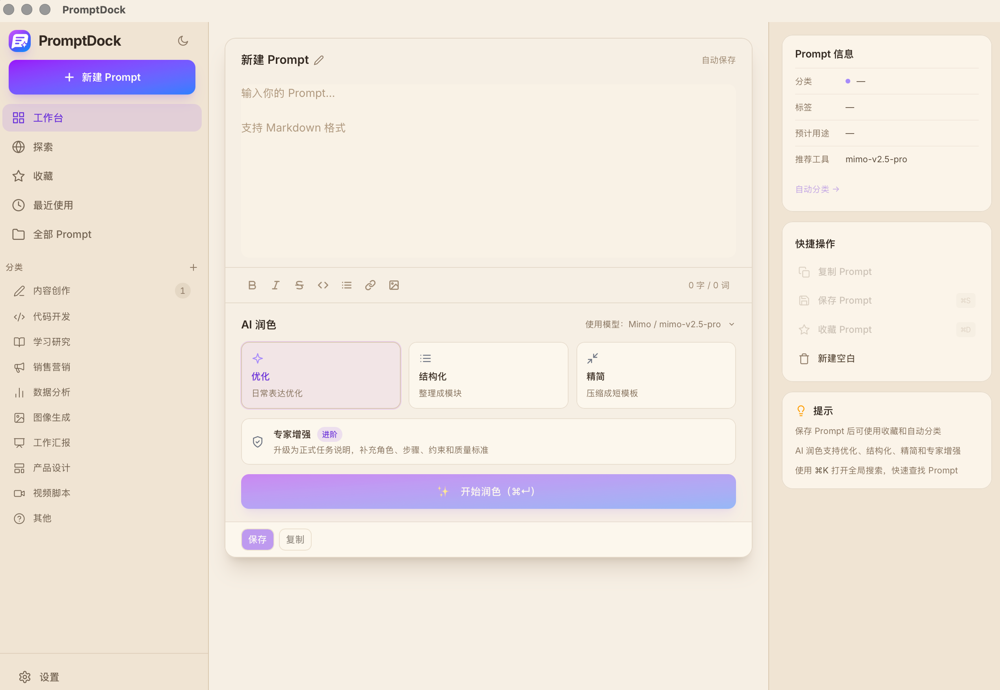

# PromptDock

PromptDock 是一款运行在 macOS 上的本地优先 Prompt 管理工具，适合保存、整理、搜索和复用常用提示词，并支持通过大模型 API 对 Prompt 进行润色和自动分类。



## 功能特性

- 新建、编辑、保存、复制、删除和收藏 Prompt
- 按分类、收藏、最近使用和全部 Prompt 浏览内容
- 搜索 Prompt 标题、正文、摘要、分类和标签
- 支持配置多个 OpenAI-compatible 模型 API
- 提供优化、结构化、精简、专家增强四种 AI 润色模式
- 支持 AI 自动分类，并为自定义分类自动匹配图标
- 支持暖纸色和深色两种主题

## 安装使用

项目内置了一个预览版 macOS universal DMG：

```text
release/PromptDock_0.1.0_universal_adhoc.dmg
```

该安装包支持 Apple Silicon 和 Intel Mac。当前版本使用 ad-hoc 签名，尚未使用 Apple Developer ID 签名和 notarization，因此首次打开时 macOS 可能会提示无法验证开发者。

完整安装和使用说明请查看：

[PromptDock 使用说明](docs/user-guide.md)

安装包校验值见：

```text
release/SHA256SUMS.txt
```

## 安全说明

PromptDock 会把 Prompt、分类、设置和模型 API Key 存储在本地 SQLite 数据库中。API Key 只会发送到你自己配置的模型接口地址，但当前版本尚未对本地数据库中的 API Key 做额外加密。

建议使用单独创建的低额度 API Key，并在不再使用时及时撤销。

## 技术栈

| 模块 | 技术 |
| --- | --- |
| 桌面框架 | Tauri v2 |
| 前端 | React 19、TypeScript、Vite |
| 样式 | Tailwind CSS v4、shadcn 风格组件 |
| 状态管理 | Zustand |
| 本地存储 | SQLite、rusqlite、FTS5 |
| AI 调用 | Rust 后端通过 reqwest 请求模型 API |
| 测试 | Rust tests、Playwright e2e |

## 本地开发

安装依赖：

```bash
pnpm install
```

启动桌面端开发模式：

```bash
pnpm tauri:dev
```

常用检查命令：

```bash
pnpm build
cd src-tauri && cargo test
cd src-tauri && cargo clippy --all-targets -- -D warnings
pnpm test:e2e
pnpm run audit:all
```

`pnpm test:e2e` 会自动安装 Playwright Chromium，并启动 Vite dev server。

Rust 依赖审计需要先安装 `cargo-audit`：

```bash
cargo install cargo-audit --locked
```

## 构建

生成 macOS `.app`：

```bash
pnpm tauri:build
```

生成 DMG：

```bash
pnpm tauri:build:dmg
```

如需正式面向普通用户分发，建议补齐 Apple Developer ID 签名、notarization 和 stapling。

## 主要 Tauri Commands

前端通过 `invoke()` 调用 Tauri 后端命令：

- Prompt 管理：`create_prompt`、`update_prompt`、`delete_prompt`、`get_prompt`、`list_prompts`、`record_prompt_use`
- Prompt 元数据：`toggle_favorite`、`get_prompt_tags`、`set_prompt_tags`、`update_prompt_meta`、`search_prompts`
- AI 能力：`polish_prompt`、`polish_prompt_stream`、`analyze_polish_process`、`auto_classify`、`test_connection`
- API 配置：`list_api_configs`、`get_active_config`、`save_api_config`、`update_api_config`、`delete_api_config`、`activate_api_config`

## 许可证

MIT
